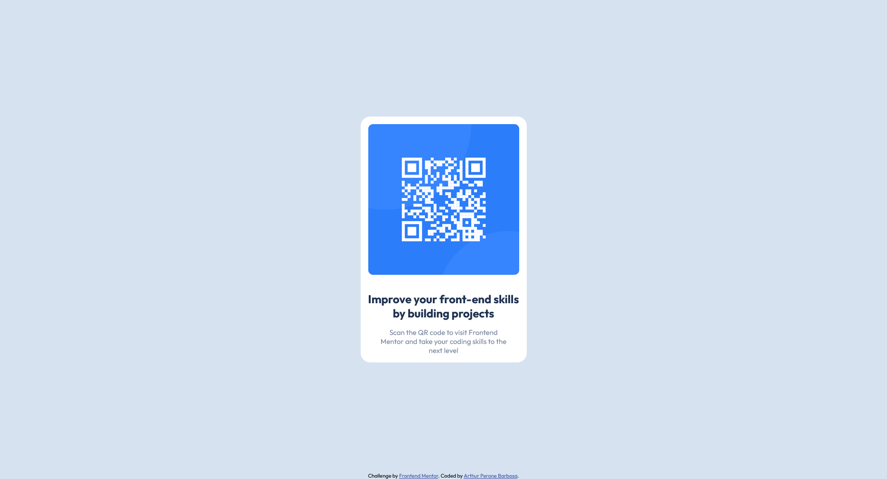

# Frontend Mentor - QR code component solution

This is a solution to the [QR code component challenge on Frontend Mentor](https://www.frontendmentor.io/challenges/qr-code-component-iux_sIO_H). Frontend Mentor challenges help you improve your coding skills by building realistic projects. 

## Table of contents

- [Frontend Mentor - QR code component solution](#frontend-mentor---qr-code-component-solution)
  - [Table of contents](#table-of-contents)
  - [Overview](#overview)
    - [Screenshot](#screenshot)
      - [Desktop](#desktop)
      - [Mobile](#mobile)
    - [Links](#links)
  - [My process](#my-process)
    - [Built with](#built-with)
    - [What I learned](#what-i-learned)
  - [Author](#author)

## Overview

### Screenshot
#### Desktop

#### Mobile

### Links

- Solution URL: [Solution](https://www.frontendmentor.io/solutions/responsive-qr-code-compontent-using-flexbox-rwlBfE6D6M)
- Live Site URL: [Live site](https://arthurperone.github.io/QRcode-component/)

## My process

### Built with

- Semantic HTML5 markup
- CSS custom properties
- Flexbox

### What I learned

This project helped me to remember some features of CSS; I used media queries a long time ago. I chose this simple challenge to make my own challenge: avoiding fixed metrics like pixels and em as much as possible. I preferred using dynamic metrics, like rem, percentages, and viewport width/height.

## Author

- Github - [Arthur Perone](https://github.com/ArthurPerone/)
- Frontend Mentor - [@ArthurPerone](https://www.frontendmentor.io/profile/ArthurPerone)
